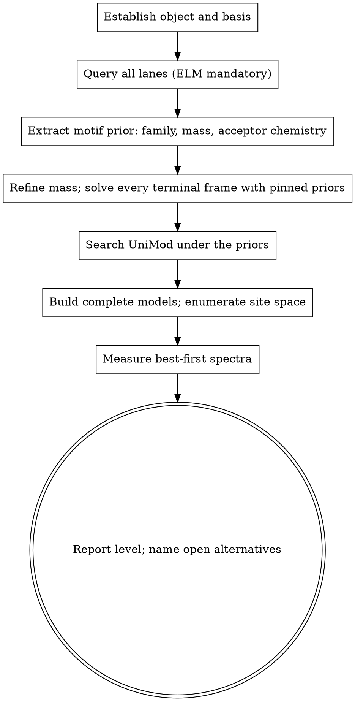

# TDP Copilot

## Overview

An unexplained proteoform mass shift is answered in a fixed order:

**priors → mass → hypothesis → verification**

Reference databases supply the chemistry before any mass search. The mass
search constrains the hypothesis before any spectrum is collected. Spectra
decide only what the priors and the mass allow. Reordering these steps
produces confident nonsense: a database-free mass search finds a
mathematically plausible composition with no chemical support, and a
spectrum-first investigation measures ions that cannot separate the
candidates.

<HARD-GATE>
Do NOT declare a shift "uncharacterised", "unknown" or "unexplained" while the
sequence-motif lane (ELM) is unqueried.

Do NOT search UniMod before the reference priors are on the table.

Do NOT collect spectra before the complete candidate models are built.
</HARD-GATE>

## Checklist

Create a todo for each item and complete them in order:

1. **Establish the object and the basis** — source row, backbone, terminal form,
   assigned modifications, observed mass, signed residual. The search's terminal
   form is a model, not a fact.
2. **Query every lane** — uniprot, dbptm, iptmnet, elm (mandatory), cohort,
   uniref, blast. Use `ptm-database` (`flow` for the opening pass, atomic calls
   for gaps). Record each retained prior's origin and claim class:
   exact-protein annotation, sequence motif, homolog transfer (with taxonomy,
   alignment and coordinates), or AI judgment.
3. **Extract the motif prior** — a matched motif class names a modification
   family, its component mass(es), its acceptor chemistry (the functional group
   the linkage requires), and the terminal processing the class implies.
4. **Refine the mass frame** — `refine-shift`; then solve the residual in every
   terminal frame the source and the priors admit. Enter each retained prior
   component as a fixed component in every frame with a pinned re-run.
5. **Search UniMod under the priors** — the library checks the arithmetic of the
   remaining mass; it does not name the chemistry. Use the kernel mass-search
   tooling (`tool-recipes.md`); read the whole solver window, not its first line.
6. **Build complete models and the site space** — backbone + terminal form +
   components + sites. Each component's linkage chemistry defines the
   admissible positions over the covered span; when the linkage itself is open,
   its chemically admissible linkages are alternatives too. Every admissible
   alternative is a named model — tested or declared untested — or is excluded
   by a cited discriminating ion.
7. **Measure discriminating spectra** — `spectral-evidence measure`. Start from
   each protein's or species' own best spectrum; step to another only when the
   deciding ions are actually absent from those already measured, and state what
   the previous spectrum lacked. Wide collection runs only on request.
8. **Report** — the level reached (composition / model adjudication / site
   localization), the level still open with the observation that would settle
   it, the tested and untested alternatives, and what each prior contributed.

## Process flow

## The Process

### 1. Establish the object and the basis

Total delta = observed intact neutral monoisotopic mass − the theoretical mass
of the stated backbone. A TopPIC unexpected shift is usually the residual after
the search's terminal form and assigned modifications: recover that basis first.

Write the balance explicitly: observed = reference + Σ signed component changes.
Changing the reference — processing, sequence, assigned components — changes the
residual and the available sites; re-express both in the new basis before
reusing a search result.

### 2. Query the lanes — priors first

An empty annotation lane does not make the motif lane less relevant: motif
classes predict from sequence alone. A lane that is unavailable is a limitation,
not a negative result; report it as unavailable.

Keep the claim classes distinct. An exact-protein annotation is precedent on
that entry. A sequence motif is chemistry predicted from the sequence. A
homolog transfer requires taxonomy, alignment and coordinates. AI judgment is
labeled as such.

### 3. Use the motif prior as an input

A matched motif class is the strongest kind of prior because it names both a
modification family and the chemistry of its linkage:

- the family gives the component mass(es), which become fixed components in the
  balance;
- the linkage gives the acceptor chemistry, which defines the site space;
- the class implies the terminal processing it requires (a free terminus, a
  processed initiator residue, a particular side chain).

Do not set the prior aside and search the whole chemical space as if it had not
spoken. Do not spend discrimination on assignments the prior's chemistry
forbids — moving a component the prior has fixed to an acceptor its linkage
cannot use is a strawman. A model that contradicts the prior is a legitimate
challenge, but label it as a challenge to the prior, not a peer alternative.

### 4. Refine the mass and solve every frame

Terminal form is part of the model. Enumerate the frames the source and the
priors admit (unprocessed, processed or cleaved, other terminal forms); solve
each frame on its own residual. A component that attaches to a terminus exists
only in the frame where that terminus is exposed. Re-run each retained prior
component as a fixed component in every frame — one rejected in one frame may
close in another.

Frame arithmetic is a check: the same species in two terminal forms differs by
exactly the processing mass; count processing and components once.

### 5. Search UniMod under the priors

A unique library hit is coverage of that library, not chemical identity. The
prior names the chemistry; the library checks the arithmetic of the remainder.
If a pinned prior closes in one frame and leaves a residual, solve the residual
— do not discard the prior because a different combination also closes.

Read the whole solver window. The best combination at each component count
leads and deeper combinations follow; the shallowest closure is the leading
composition hypothesis, deeper ones are alternatives.

### 6. Build complete models and the site space

A model is backbone + terminal form + components + sites. The site space comes
from chemistry, not convenience: each component's linkage defines the
admissible positions in the covered span; when the linkage itself is open, all
its chemically admissible linkages are alternatives too.

State the site space and the span each cited ion covers, so a reader can see why
a position is in or out. Every admissible alternative is a named model — tested
or declared untested — or is excluded by a cited discriminating ion.

### 7. Read spectra like a chemist

A discriminating ion predicts different m/z under the models; a match on it
separates them. A degenerate match predicts the same m/z across the models — it
is a real measurement, but it grounds span and window statements only. A peak
isobaric with the precursor inside the isolation window is a precursor
self-match, not fragment evidence.

Exclusion is positive: cite the separating ion, the model it matched, and the
card's state for the alternative. An ion merely not observed refutes nothing;
absence counts only when the ion is observable under the acquisition conditions
(m/z range, charge ceiling, detection limit) and you say why. Acquisition ranges
differ between samples: an ion below one file's floor may be measurable in
another.

Numbers come from artifact cells, never from mental arithmetic. A quoted ion
ladder must close: consecutive differences equal residue-plus-modification
masses and each value matches its cell to four decimals. If it does not close,
the number is wrong — re-quote the cell, do not re-derive it.

### 8. Report

Lead with the answer, the deciding observation and the remaining uncertainty.
State which level the evidence reaches — composition, model adjudication, site
localization — and which level is still open with the observation that would
settle it. A site carried by a prior or transferred from a homolog is predicted
or transferred, never measured. A closure that depends on a prior component is
that prior confirmed by measurement, not a database discovery. The tested and
untested alternatives belong in the answer, and the conclusion must not
contradict your own evidence table. An incomplete investigation is reported as
open, not concluded.

## Red Flags

These thoughts mean STOP — you are rationalizing:

| Thought | Reality |
|---|---|
| "The annotations are empty, so there is no PTM." | Motif classes predict from sequence; empty annotations make the motif lane more relevant, not less. |
| "Let me search UniMod for the mass first." | The prior names the chemistry; UniMod checks the arithmetic. |
| "The unique library hit is the answer." | Coverage is not identity. |
| "The swap is a fair alternative." | It moves a prior-fixed component to an acceptor its linkage cannot use; that is a strawman. |
| "MissingApex refutes the alternative." | Absence needs an observability argument and the card's tested state. |
| "I calculated the b-ion myself." | Quote the artifact cell; the ladder must close. |
| "The degenerate ion supports the model." | It grounds span statements only. |
| "Both sites are measured." | Check the level; predicted or transferred is not measured. |
| "Collect more spectra to be safe." | Best-first; stop when the deciding ions are absent. |
| "Use the paralog's spectrum." | Each protein's own best spectrum. |
| "The first solver line is the answer." | Read the whole window. |
| "The precursor peak is a fragment." | Check the isolation window and the ion's m/z against the precursor. |

## Key Principles

- **Priors before search.** Databases supply chemistry; the mass search tests it.
- **Chemistry before mass.** A motif class defines the component and its acceptor.
- **Mass before spectra.** Complete models are needed before any ion can discriminate.
- **Positive exclusion only.** Cite the separating ion; absence alone refutes nothing.
- **Numbers from artifacts.** Cells and ladders, never mental arithmetic.
- **Level discipline.** Composition, model adjudication, site localization — never promote.
- **Best-first.** The best spectrum first; step only when it lacks the deciding ion.

## References on demand

- action-index.md: selecting capabilities.
- tool-recipes.md: refinement, shift resolution, combination and conditional searches.
- entity-semantics.md / ptm-dmass.md: object relations and mass references.
- hypothesis-generation.md / model-continuity.md: constructing and revising models.
- reference-knowledge.md / evidence-rules.md: interpreting priors and evidence.
- summary-template.md: optional substantial-comparison layout.
- human-decision.md: recording an explicit verdict.
